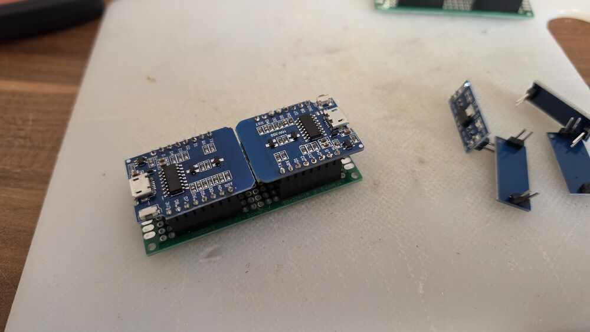
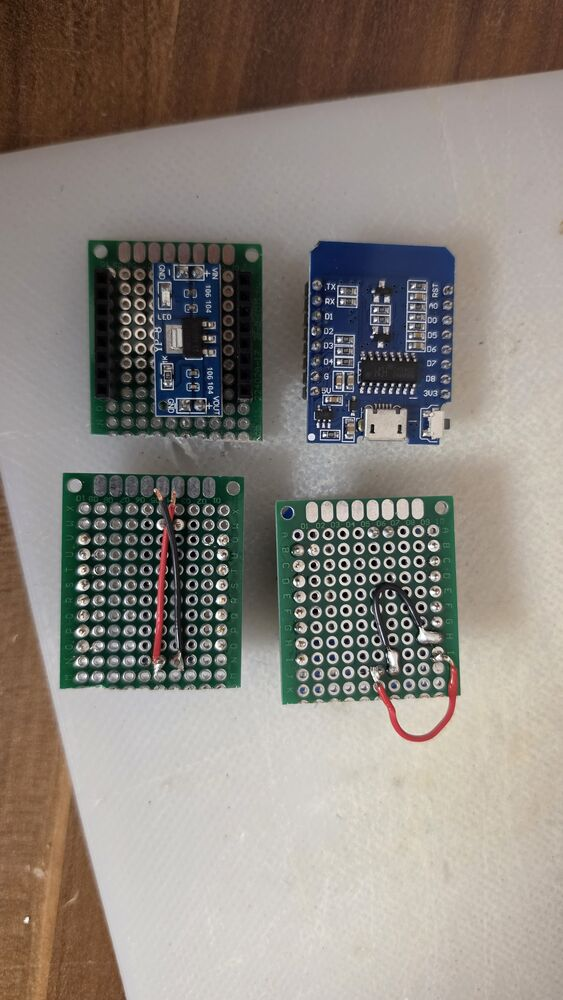
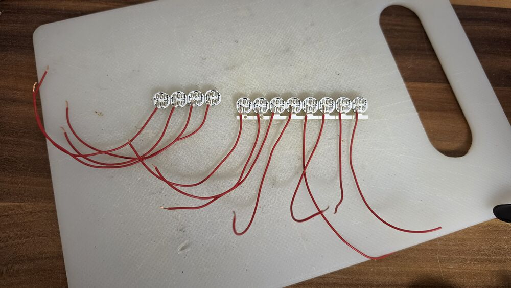
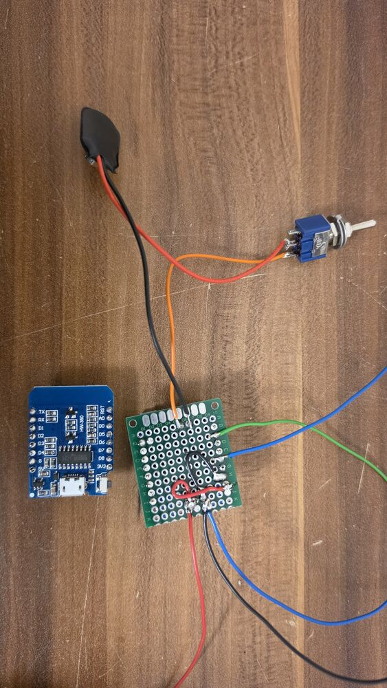
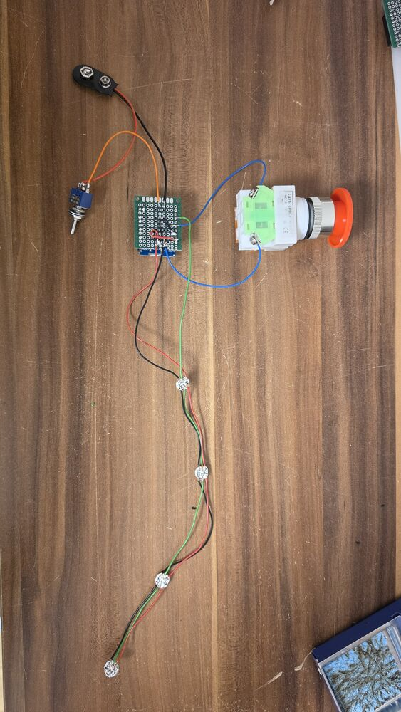
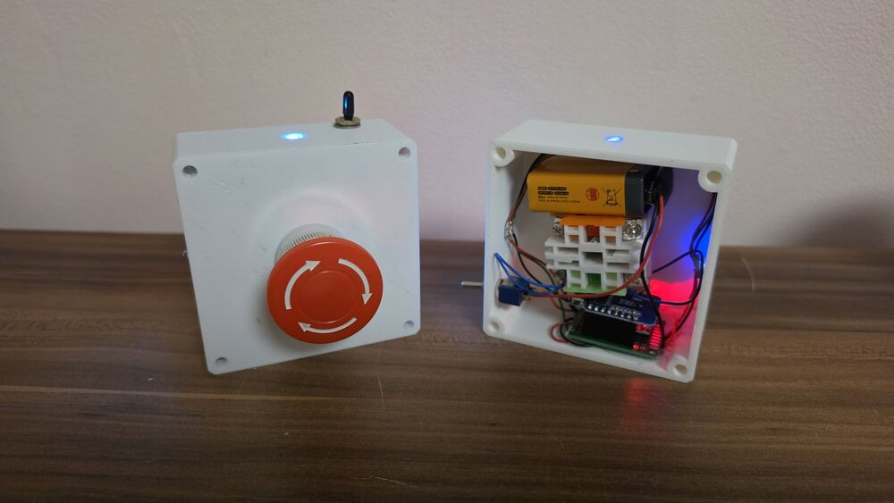
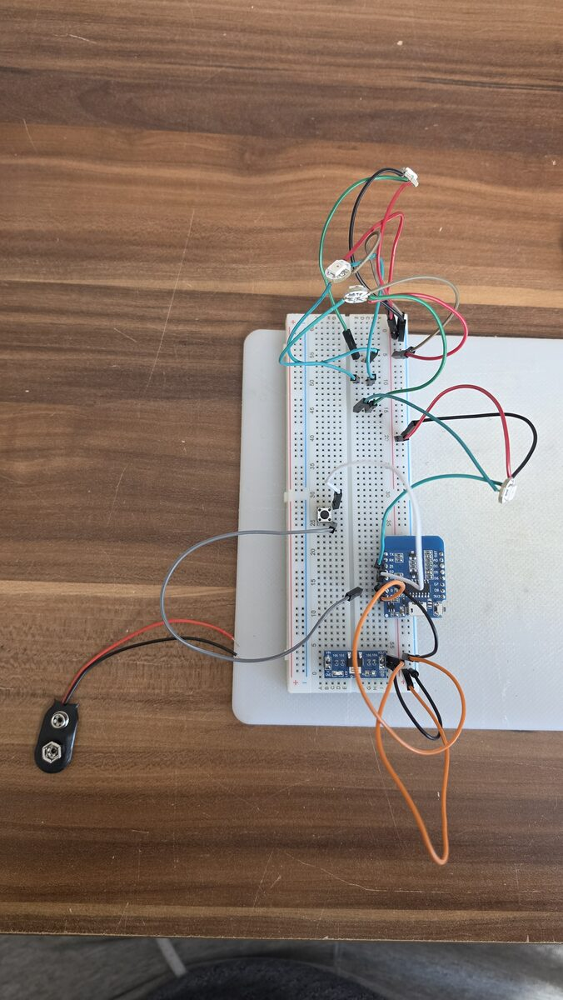
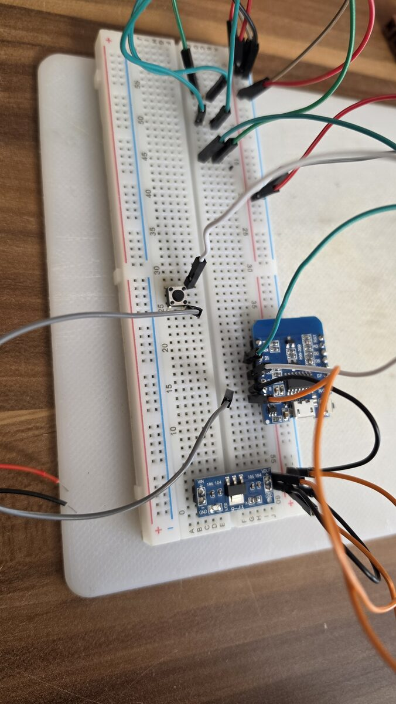
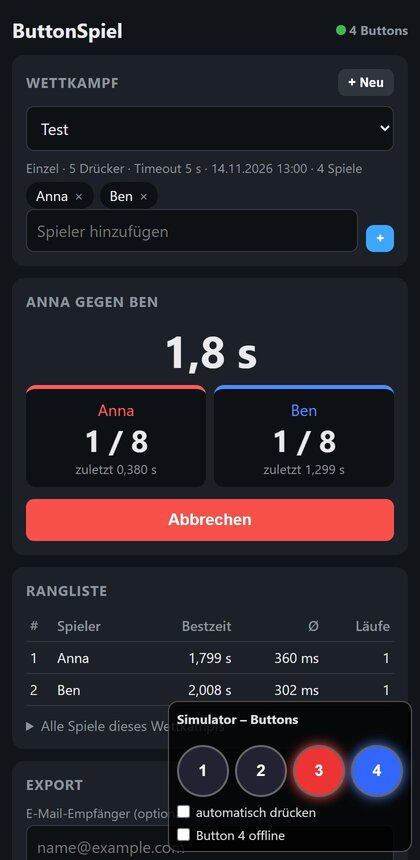

# ButtonSpiel – Reaktionsspiel mit ESP8266-Buttons

Mehrere Buttons (ESP8266 + Taster + WS2812B-Ring) spielen ohne Router zusammen, gesteuert über eine
Web-App auf dem Handy. Zwei Spielmodi:

- **Einzel:** ein Spieler nach dem anderen. Nach dem Start leuchtet zufällig ein Button (rot), der muss
  gedrückt werden, dann der nächste. Wertung: Summe der Reaktionszeiten; ein verpasster Button (Timeout) zählt
  mit der vollen Timeout-Zeit, ein Druck auf einen nicht leuchtenden Button kostet +0,5 s.
- **Duell (Farb-Rennen):** zwei Spieler gleichzeitig auf denselben Buttons. Rot und Blau haben jeweils ihren
  eigenen leuchtenden Button (nie derselbe). Jeder drückt nur seine Farbe. Wer zuerst alle Drücker geschafft hat,
  gewinnt (Laufzeit inkl. Laufwege). Fehldrücke werden im Duell nicht bestraft, weil kein Button weiß, wer drückt.

## Bedienung
1. Alle Buttons einschalten. Der erste, der keinen anderen hört, wird **Zentrale** (atmet türkis),
   alle anderen atmen blau.
2. Mit dem Handy ins WLAN **ButtonSpiel** (offen) gehen. Die App öffnet sich als Portal-Seite,
   sonst `http://192.168.4.1/` aufrufen.
3. **Wettkampf anlegen** (+ Neu): Name, Modus (Einzel/Duell), Spieler, Drücker, Timeout.
   Es können beliebig viele Wettkämpfe nebeneinander existieren (z. B. 9 Uhr Einzel, 11 Uhr Einzel, 15 Uhr Duell);
   oben wird der aktive gewählt. Spieler lassen sich später ergänzen.
4. Einzel: Spieler antippen → sein Lauf startet. Duell: Rot und Blau wählen → „Duell starten“.
5. Rangliste je Wettkampf: Einzel nach Bestzeit, Duell nach Siegen (dann Niederlagen, dann Bestzeit).
6. **Testmodus** (Karte „Buttons“ ganz unten): Alle Buttons zeigen nacheinander rot, grün, blau und weiß,
   danach läuft ein einzelnes Licht durch den Ring. So fällt eine tote LED sofort auf, denn alle LEDs dahinter
   bleiben dunkel. Jeder Tastendruck blitzt weiß und wird in der App pro Button gezählt. „Testmodus beenden“
   schaltet zurück, danach kann wieder gespielt werden.

## Daten und Export
- Wettkämpfe und Ergebnisse liegen im **Browser-Speicher (localStorage) des Handys** – nicht auf den ESPs.
  Sie überleben Neustarts der Buttons und Wechsel der Zentrale, sind aber nur auf diesem Handy und in diesem Browser.
  Browserdaten löschen (z. B. „Feuer“-Knopf in DuckDuckGo) löscht auch die Wettkämpfe!
- Die Zentrale hält die letzten 10 Ergebnisse vor (mit eindeutiger ID), damit das Handy nach einem
  Verbindungsabbruch nichts verpasst.
- **Export:** Umfang wählen (dieser Wettkampf / alle), dann
  - **„CSV-Datei speichern / teilen“** – echte Datei für einen Mail-Anhang. Kann der Browser Dateien teilen, öffnet sich
    das Android-Teilen-Menü direkt (geht meist nur unter HTTPS, das ESP liefert http). Sonst lädt die App die CSV
    zur Zentrale hoch (`POST /csv`, wird in deren Flash/LittleFS gestreamt, max. 256 KB) und lädt sie von dort
    wieder herunter (`GET /csv` mit `Content-Disposition`) – nur so bekommt die Datei in jedem Browser ihren Namen
    `ButtonSpiel_<Wettkampf>_<Datum>.csv` (DuckDuckGo benennt Browser-interne Downloads nach einer Zufalls-ID).
    Die Datei liegt dann in *Downloads*; in Gmail über die Büroklammer → Dateien anhängen oder in der
    Download-Meldung „Teilen“.
  - „Als Mail-Text“ – `mailto:`-Entwurf mit der CSV im Text (mailto kann keine Anhänge).
  - „CSV anzeigen / kopieren“ als Ausweg.
  Verschickt wird, sobald das Handy wieder Internet hat. Die Datei beginnt mit einem BOM, damit Excel Umlaute richtig zeigt.
- CSV (Semikolon, für deutsches Excel): eine Zeile pro Spieler und Spiel –
  `Wettkampf;Datum;Uhrzeit;Modus;Spieler;Farbe;Gegner;Ergebnis_ms;Sieg;Platz;Reaktionssumme_ms;Verpasst;Falsch;Druecker;Zeiten_ms`.

## LED-Farben
| Muster | Bedeutung |
|---|---|
| schwach weiß | sucht die Zentrale (Bootphase) |
| türkis atmend | Zentrale, bereit |
| blau atmend (langsam) | Button, bereit |
| gelb blinkend | Button hat die Zentrale verloren (nach 15 s Neustart + neue Wahl) |
| weiß blinkend | Countdown |
| rot laufend | **drücken!** (Einzel, Duell Spieler Rot) |
| blau laufend | **drücken!** (Duell Spieler Blau) |
| grün kurz / orange kurz | Treffer / Fehldruck |
| Regenbogen / lila | Einzel-Ergebnis: neue Bestzeit im Wettkampf / sonstiges Ergebnis |
| rot / blau pulsierend | Duell-Ergebnis: Rot / Blau hat gewonnen (lila = unentschieden) |
| blau schnell | „Zeigen“ aus der App |
| rot, grün, blau, weiß, dann Lauflicht | Testmodus; ein Druck blitzt weiß |

## Hardware
Jeder Button ist gleich aufgebaut; es werden mindestens zwei gebraucht (einer wird automatisch Zentrale).


### Stückliste (pro Button)
| Teil | Hinweis |
|---|---|
| Wemos D1 mini (ESP8266) | NodeMCU geht auch |
| 4× WS2812B (Einzel-LEDs in Kette, oder ein Ring) | an **+5 V**, nicht an 3V3; Anzahl in `config.h` (`NUM_LEDS`) |
| Taster (Schließer), z. B. großer Pilztaster | zwischen D3 und GND, **kein Widerstand nötig** |
| AMS1117-5.0-Modul + 7–12-V-Quelle | oder Powerbank direkt am USB des Wemos |
| 330-Ω-Widerstand | empfohlen, in der Datenleitung vor der ersten LED |
| Elko 470–1000 µF / 10 V | empfohlen, zwischen +5 V und GND an den LEDs |
| Ein/Aus-Schalter | empfohlen, z. B. Kippschalter in der Plus-Leitung der Batterie |
| Lochrasterplatine, Buchsenleisten, Batterieclip, Gehäuse | Wemos und Regler gesteckt, damit sie tauschbar bleiben |

### Verdrahtung
| Wemos | geht an |
|---|---|
| 5V | +5 V (VOUT des Reglers), VDD aller LEDs |
| G | GND von Regler, LEDs und Taster |
| D1 (GPIO5) | über 330 Ω an DIN der ersten LED; DOUT → DIN der nächsten |
| D3 (GPIO0) | Taster gegen GND (interner Pull-up + 10 kΩ auf dem Board) |

Hinweise:
- D3 ist GPIO0: Ist der Taster beim Einschalten gedrückt, startet der ESP im Flash-Modus statt im Spiel.
- Ein 9-V-Block reicht nur wenige Stunden (wenig Kapazität, der Linearregler verheizt fast die Hälfte).
  Für den Dauerbetrieb besser Li-Ion-Akku + Lademodul (z. B. TP4056 mit Schutz) + 5-V-Aufwärtswandler oder eine Powerbank.
- Pins ändern: `src/config.h` (`LED_PIN`, `BUTTON_PIN`, `NUM_LEDS`, `LED_BRIGHTNESS`).
- Schaltplan neu erzeugen: `python docs/schematic.py` (braucht `pip install schemdraw`).

### Aufbau
So sind die vier Buttons entstanden:

| | |
|---|---|
|  |  |
| **1.** Der Wemos steckt auf Buchsenleisten und lässt sich zum Flashen oder Tauschen abziehen. | **2.** Das AMS1117-Modul sitzt auf einer kleinen Lochrasterplatine; +5 V und GND laufen als Brücken über die Platine. |
|  |  |
| **3.** Die WS2812B-Einzel-LEDs vorher mit Drähten versehen. Auf die Pfeilrichtung achten: Die Daten gehen von DOUT zu DIN der nächsten LED. | **4.** Batterieclip und Kippschalter an den Regler, die Leitungen für Taster und LEDs an die Platine. |
|  |  |
| **5.** Vor dem Einbau alles zusammen testen (siehe unten). | **6.** Fertig: Pilztaster im Deckel, Batterie und Elektronik im Gehäuse. |

**Nach dem Löten testen.** Wemos per USB anschließen und den Hardwaretest aufspielen:

```
pio run -e hwtest -t upload
```

- **LEDs:** Alle LEDs leuchten nacheinander rot, grün, blau und weiß. Danach läuft ein einzelnes Licht durch die Kette.
  Bleibt das Licht an einer LED stehen, ist die Lötstelle davor schuld.
- **Taster:** Solange er gedrückt ist, blitzen alle LEDs weiß. Im seriellen Monitor (115200 Baud) erscheint
  `Taster GEDRUECKT`, und `D3 = LOW` zeigt den Pegel direkt.
- **Wenn nichts geht:** `pio run -e pinscan -t upload`. Dann bekommt jeder Pin von D1 bis D7 eine eigene Farbe
  (D1 rot, D2 grün, D3 blau, D4 weiß, D5 gelb, D6 türkis, D7 lila), und Tastendrücke werden pro Pin gezählt.
  So sieht man sofort, ob etwas am falschen Pin hängt.

Typische Fehler beim Bau dieser Buttons:
- **Das D3-Pad hat keinen Kontakt zum Stift der Buchsenleiste.** Die Lötstelle sah gut aus, aber D3 blieb immer `HIGH`.
  Das Lot muss Pad und Stift verbinden, sodass ein glänzender Kegel entsteht und keine Kugel auf dem Pad.
- **Fehler in der LED-Verdrahtung.** Die LEDs flackerten, und der Taster reagierte nicht. Ohne LEDs funktionierte
  der Taster, nach neuem Anlöten der LEDs lief alles. Also LED-Drähte und Pads auf Brücken prüfen,
  vor allem zur Taster-Leitung und zwischen DIN, + und GND.
- **5V und G liegen direkt nebeneinander.** Vor dem ersten Einstecken mit dem Durchgangsprüfer messen, dass sie nicht verbunden sind.

Sind alle Buttons fertig, wieder die Spiel-Firmware aufspielen (`pio run -t upload`) und in der App mit dem
**Testmodus** alle gemeinsam prüfen.

### Prototyp auf dem Steckbrett
<p>
  
  
</p>

## Bauen und Flashen
Mit [PlatformIO](https://platformio.org/) (VS Code-Erweiterung oder CLI):

```
pio run -t upload        # bauen und flashen
pio device monitor       # serieller Monitor, 115200 Baud
```

**Alle** Buttons müssen dieselbe Firmware-Version haben (siehe Funkprotokoll unten).

Zum Prüfen frisch gelöteter Buttons gibt es einen Hardwaretest, siehe [Aufbau](#aufbau).

## Technik
- Alle Geräte haben dieselbe Firmware; die Zentrale wird beim Booten gewählt (`main.cpp`).
- Funk: ESP-NOW-Broadcast auf Kanal 1 (`radio.cpp`, Format in `protocol.h`, Version 3: zwei „Lanes“ für
  das Duell und der Testmodus – Geräte mit älterer Firmware werden ignoriert, also immer **alle** Buttons flashen).
  Die Zentrale sendet den Spielzustand alle 100 ms und bei jeder Änderung; ein Button misst seine Reaktionszeit
  selbst (LED an → Druck), Funklatenz zählt also nicht.
- Zentrale: Spielleitung für Einzel und Duell (`gateway.cpp`), eigenes WLAN + Webseite + WebSocket `/ws` auf
  Port 80 (`web.cpp`, `webpage.h`). Wettkämpfe/Ranglisten kennt nur die App.
  Der Webserver ist **asynchron** (ESPAsyncWebServer): ein langsames oder schlafendes Handy darf die Spielschleife
  nie blockieren, sonst kommt der Spielzustand nicht mehr bei den Buttons an (gelbes Blinken). Blockiert die Schleife
  doch einmal länger als 100 ms, steht `Loop stalled … ms` im seriellen Log.
- Verdrahtung: LEDs an D1 (4× WS2812B), Taster an D3 gegen GND – siehe [Hardware](#hardware).
- Ein Gerät mit gespeicherten WLAN-Zugangsdaten (z. B. aus einer älteren Firmware mit WiFiManager) verbindet sich
  nicht mehr mit dem Router, damit der Funkkanal fest bleibt.

## Simulation im Browser (ohne Hardware)
Die Handy-App lässt sich ohne ESP, Taster und LEDs ausprobieren: `tools/simulator` startet einen kleinen Webserver,
der die Seite aus `src/webpage.h` ausliefert (immer die aktuelle Version) und statt der Zentrale ein simuliertes
Gateway im Browser laufen lässt (`mock.js`, bildet `gateway.cpp` nach: Countdown, Ziele, Timeout, Fehldrücke,
Einzel und Duell, Ergebnisse, CSV-Export).

```
python tools/simulator/simulate.py              # öffnet http://127.0.0.1:8765/ im Browser
python tools/simulator/simulate.py --units 6 --bot
```

| Option | Bedeutung |
|---|---|
| `--units N` | Anzahl simulierter Buttons (1–10, Standard 4) |
| `--bot` | Buttons drücken sich selbst nach 180–650 ms (zum Zuschauen) |
| `--port P` | anderer Port (Standard 8765) |
| `--no-browser` | Browser nicht automatisch öffnen |

Rechts unten erscheinen die virtuellen Buttons: der leuchtende (rot = Einzel/Spieler Rot, blau = Spieler Blau)
muss angeklickt werden; ein Klick auf einen anderen zählt als Fehldruck. Dort lassen sich auch „automatisch drücken“
und „Button offline“ umschalten. Nur Python 3 nötig, keine weiteren Pakete. Wettkämpfe landen wie auf dem Handy
im localStorage dieses Browsers (unter `127.0.0.1:<Port>`).



## Testen mit echten Boards, aber ohne Taster/LED-Ring
- Ein nacktes Board reicht. Beim NodeMCU ist der **FLASH-Taster** GPIO0 = D3 = Spieltaster.
  Ein Wemos D1 mini hat nur **RST** (startet neu!) – dort D3 kurz mit GND verbinden oder `autoplay.py` nutzen.
  Die **blaue Onboard-LED** (GPIO2) leuchtet, wenn der Ring hell wäre (Ziel, Countdown, Ergebnis …).
- Serielle Befehle (115200 Baud, mit Zeilenende):
  - `press` – Tastendruck simulieren (jede Rolle)
  - `gateway` – dieses Board wird Zentrale; läuft schon eine, gewinnt die mit der kleineren MAC, die andere startet neu
  - nur auf der Zentrale: `start <name> [drücker] [timeout_ms]` (Einzel), `duel <rot> <blau> [drücker] [timeout_ms]`,
    `abort`, `state`, `results`, `identify <n>`
- `tools/autoplay.py COM4 COM7 COM8`: drückt jeden Button per USB, sobald er leuchtet (Log-Zeile `Lit turn n lane X`),
  nach 180–650 ms – Spiel am Handy starten und zuschauen.
- `tools/hwtest.py COM4 COM7 COM8` (mit dem PlatformIO-Python, braucht pyserial): resettet die Boards,
  prüft die Zentralen-Wahl, spielt zwei Einzel-Spiele (inkl. Fehldruck und Timeout) und testet den Ausfall der Zentrale.
- Vor dem Flashen per `esptool read_mac` prüfen, welches Board an welchem COM-Port hängt – die Nummern wechseln
  beim Umstecken, und ein per USB angeschlossenes Handy erscheint ebenfalls als COM-Port.

## Lizenz
[MIT](LICENSE)
