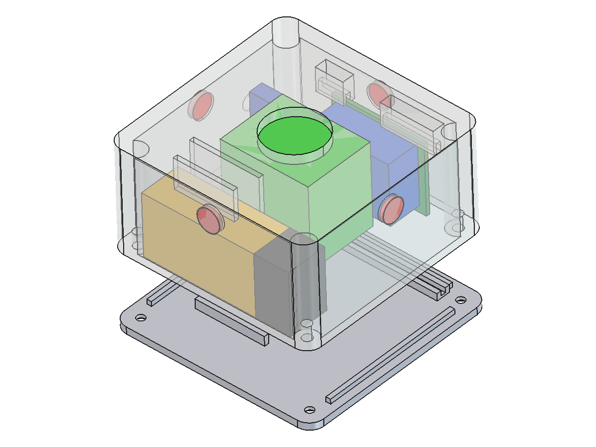

# Gehäuse (3D-Druck)

> **Prototyp – das finale Design folgt.**
> Der Probedruck von V5 hat gepasst. V6 hält die LEDs mit waagerechten Schiebeklammern statt Heißkleber. V6b gibt den Kabeln
> unter der Klammer mehr Platz und hält das Lochraster an der Kante senkrecht. V6c lässt in dieser Kantenführung einen
> Durchgang für die LED-Kabel; noch nicht gedruckt.



*Haube transparent, Boden nach unten weggezogen. Grün: Kontaktblock des Not-Aus, gelb: 9-V-Block (schwarz: Platz für den Clip),
blau: Wemos auf dem Lochraster und Kippschalter, rot: die vier LEDs.*

## Aufbau
Das Gehäuse besteht aus zwei Teilen:

- **Haube** (Decke und vier Wände in einem Stück). Sie trägt alles:
  - den Not-Aus-Pilztaster in der Decke (Loch Ø 24,4 mm),
  - je eine WS2812-LED in jeder Seitenwand: eine Tasche von innen, vor der LED bleiben 0,8 mm Wand stehen.
    Um jede Tasche sitzt ein kleiner Rahmen als Führung für die LED-Klammer: Lippe an der Decke, zwei Stützen an den
    Enden, unten Boden und Lippe als Brücke. Er druckt sich ohne Support,
  - den Kippschalter in einer Seitenwand (Loch Ø 6,4 mm),
  - eine Rippe mit Nut an der Decke, die die Oberkante des Lochrasters hält,
  - zwei Rippen, die den 9-V-Block seitlich und von oben halten.
- **4 LED-Klammern**, kleine Schiebeteile. Jede wird waagerecht, in Richtung der Kabel, in den Rahmen
  geschoben, hinter der Stütze am offenen Ende vorbei bis zum Anschlag. Zwei Stege drücken nur oben und unten auf den Platinenrand (dort sitzen keine Pads),
  dazwischen bleibt Platz für die Lötpunkte, und die Kabel laufen links und rechts unter der Klammer heraus.
- **Bodenplatte**, abnehmbar mit 4 Senkkopfschrauben von unten. Darauf liegen die untere Nut für das Lochraster und eine kleine Leiste vor der Batterie.

Zum Arbeiten die Haube kopfüber hinlegen und den Boden abschrauben. Dann liegt alles offen, und die Kabel zum Not-Aus müssen nicht gelöst werden.

Außenmaß: **86 × 86 × 47 mm** (innen 80 × 80 × 40 mm).

## Druck
| Datei | Ausrichtung |
|---|---|
| `haube.step` / `haube.stl` | Oberseite auf dem Druckbett, kein Support |
| `boden.step` / `boden.stl` | Außenseite unten, kein Support |
| `klammer.step` / `klammer.stl` | **4×** drucken, flach, kein Support; 0,12–0,16 mm Schichthöhe, 100 % Füllung |

PrusaSlicer liest STEP direkt; das gibt glattere Rundungen als STL.

Bewährte Einstellungen für PLA:
- Schichthöhe 0,2 mm
- 4 Umfänge
- 5 obere und untere Massivschichten
- 30 % Gyroid als Füllung

Damit die LEDs durch die 0,8-mm-Wand leuchten, braucht es **weißes oder naturfarbenes** Filament. Bei farbigem Filament im
Skript `LED_DURCHBRUCH = True` setzen. Dann bekommt jede LED ein 5-mm-Loch nach außen.

## Teile
| Teil | Maß / Hinweis |
|---|---|
| Not-Aus-Pilztaster (Typ LAY37) | Gewinde Ø 24 mm, Kontaktblock 38 × 30 mm, 35 mm tief unter der Decke, ohne Verdrehnase |
| 9-V-Block mit Clip | liegt auf der Schmalseite an der Wand, am Kontakt-Ende sind 15 mm frei für den Clip |
| Lochraster mit Wemos D1 mini | steht senkrecht in zwei Nuten, die +X-Kante zusätzlich in einer senkrechten Führung (`PCB_KANTE_X`); Breite bis ca. 50 mm, Höhe 29–33 mm; der Wemos zeigt nach innen |
| Kippschalter EIN/AUS/EIN | Gewinde 6 mm, Korpus 6 × 15 × 18 mm (inkl. Lötpunkte) |
| 4× WS2812B-Plättchen | Ø 9,5 mm, Leuchtfläche Ø 5 mm, 3,2 mm dick (Platine + LED, `LED_DICKE`), Lötpunkte hinten 0,6 mm; 6 Pads in zwei Spalten, Kabel Ø 1 mm gehen seitlich weg |
| 4× Einschmelzmutter M3 | Loch Ø 4,0 × 6 mm (z. B. M3 × 5,7), von unten in die Eckdome |
| 4× Senkkopfschraube M3 × 8 (ISO 10642) | halten den Boden |
| 4× Gummifuß Ø 10 mm | optional, Mulden in der Bodenplatte |

**Reihenfolge beim Zusammenbau:** erst die LEDs: Plättchen in die Tasche legen, Kabel waagerecht nach links und rechts
legen, Klammer von der offenen Seite in den Rahmen über die Kabel bis zum Anschlag schieben. Dann Lochraster und
Batterie einsetzen und zuletzt den Boden aufschrauben. Zum Lösen mit einer Nadel im Loch der Klammer zurückschieben.

Sitzt die Klammer zu stramm oder wackelt die LED, im Skript `LED_ANDRUCK` (Standard 0,15 mm) oder `KL_T` anpassen und nur die
Klammer neu drucken. Ist das Plättchen dicker als 2,4 mm, bekommt die Wand innen automatisch einen flachen Sockel (hier 0,85 mm).

Der USB-Anschluss des Wemos ist im Gehäuse nicht erreichbar. Zum Flashen den Boden abnehmen und den Wemos abziehen.
Wer einen Schlitz in der Wand möchte, setzt im Skript `USB_SCHLITZ = True`.

## Anpassen
Das Gehäuse ist parametrisch in [build123d](https://github.com/gumyr/build123d) (Python) beschrieben. Alle Maße stehen
oben in `gehaeuse.py`.

```
pip install build123d
python export.py
```

`export.py` erzeugt die Druckdateien neu und prüft dabei:
- ob sich Bauteile überschneiden, gegen Platzhalter mit den Maßen aus der Tabelle oben,
- ob die Klammern Lötpunkte und Kabel frei lassen und neben jedem Halter Platz zum Einschieben ist.

Die Dateien `_ref_*.step` sind diese Platzhalter in Einbaulage. Mit ihnen lässt sich das Gehäuse z. B. in FreeCAD
zusammen mit den Bauteilen ansehen.

## Entwicklung
Wie das Gehäuse in fünf Schritten entstanden ist:

1. **V1:** stehende Box mit dem Taster vorne. Zu hoch, weil die alte Box beim Fotografieren nur hochkant stand.
2. **V2:** flache Box nach den Maßen der alten Kaufbox (innen 78 × 78 × 37 mm), LEDs in den Seitenwänden.
3. **V3:** Das Lochraster wird nach Bedarf zugeschnitten. Deshalb halten es Nuten statt Schienen fester Breite. Der 9-V-Block
   liegt nicht mehr in einer Wanne, damit der Clip Platz hat.
4. **V4:** Lochraster an der Wand, der Wemos zeigt nach innen; USB-Loch geschlossen; Kippschalter Richtung Ecke versetzt.
5. **V5:** umgedreht. Alles hängt an der Haube, der Boden lässt sich abnehmen. Im Slicer fiel noch auf, dass die Nut-Rippe nur
   1,3 mm vor einer LED-Tasche lag. Die Rippe ist dort jetzt ausgespart, und `export.py` prüft den Einbauraum vor den LEDs.
6. **V6:** Der Probedruck von V5 passte. Damit die LEDs ohne Heißkleber halten, gibt es eine Schiebeklammer, die die Platine
   ins Fenster drückt. Ein erster Entwurf mit senkrechten Seitenschienen hätte die seitlich abgehenden Kabel blockiert; jetzt
   wird waagerecht geschoben. Die untere Führung war zuerst eine 45°-Schräge, die kopfüber gedruckt frei in der Luft
   begann; jetzt ist sie eine Brücke zwischen zwei Stützen. Weil der Halter 4,6 mm aufträgt, steht das Lochraster 1 mm weiter von der Wand weg (6 mm).
7. **V6b:** Beim Probedruck passten die Kabel mit Lötpunkten nicht sauber unter die Klammer. Der Spalt ist deshalb 0,25 mm
   größer (`KABEL_LUFT`), der Halter ragt jetzt 4,85 mm in den Raum. Außerdem kippte das Lochraster beim Aufsetzen des Bodens
   um. An seiner +X-Kante (gegenüber dem Kippschalter) hält es jetzt eine senkrechte U-Nut, die von der Decke wächst und am
   Eckdom hängt, also ohne Stütze druckbar ist. Die Lage der Kante steht in `PCB_KANTE_X`, die Nut greift 3 mm (`HAKEN_GRIFF`).
8. **V6c:** An der Kantenführung laufen auch die LED-Kabel an der Platine vorbei. Auf halber Höhe hat die Führung deshalb
   ein Fenster durch beide Nutwände (18–26 mm über der Bodenplatte, `DURCHGANG_*`); die Kabel laufen übereinander durch den
   etwa 2 mm breiten Spalt zwischen Platinenkante und Nut-Ende. Die Unterkante des Fensters steigt unter 45° zum Eckdom an,
   damit der Rest der Führung kopfüber ohne Überhang weiterwächst. `export.py` prüft, dass drei Adern durchpassen.
